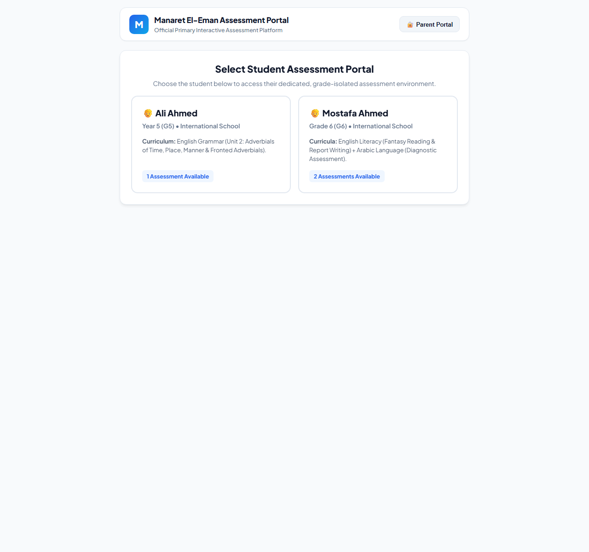
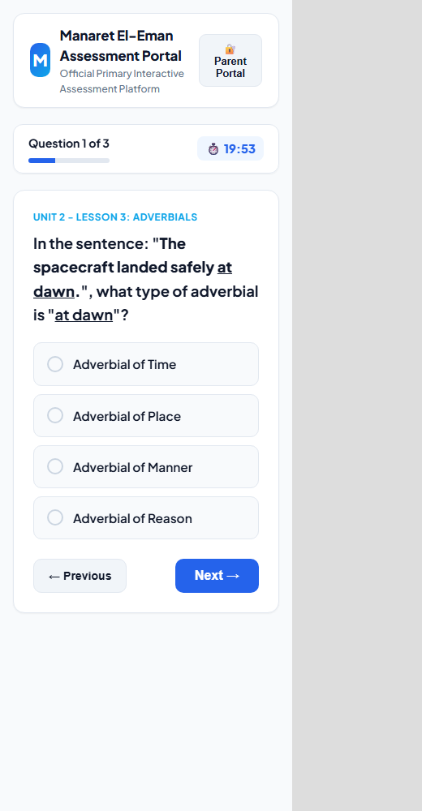

# مراجعة شاملة لمنظومة امتحانات الصفين الخامس والسادس

**تاريخ المراجعة:** 24 أكتوبر 2026  
**النطاق:** `Code.gs`، `Index.html`، `Question_Bank.csv`، `Exams.csv`، سكربتات Python، ودليل الإعداد.  
**طريقة المراجعة:** قراءة الكود سطراً بسطر، تحليل بيانات بنك الأسئلة، محاكاة مولّدات الأسئلة (300 محاولة لكل امتحان)، اختبار دوال الخادم بوحدات وهمية، ومعاينة الواجهات محلياً على مقاسات سطح المكتب والموبايل.

> **حدود المراجعة:** لم يتم النشر على بيئة Google Apps Script حية، ولا يوجد اختبار حمل أو اختبار اختراق فعلي. النتائج مبنية على التحليل الساكن، ومحاكاة الدوال، ومعاينة HTML. بعض المشكلات الأمنية تحتاج تأكيداً على بيئة النشر الفعلية، لكن أسبابها واضحة في الكود.

> **تحديث 2026-10-25:** نُفذت إصلاحات جوهرية بعد هذه المراجعة: التصحيح، جلسات الخادم، فرض المحاولات، التهيئة غير المدمّرة، ربط بنك الأسئلة، Google Form، وبعض إصلاحات الواجهة وXSS. راجع [`FIXES_APPLIED.md`](FIXES_APPLIED.md) لمعرفة ما تغيّر وما تبقّى. يبقى هذا التقرير مرجعاً للحالة **قبل** الإصلاح.

---

## 1. الملخص التنفيذي

المشروع **نموذج أولي واعد** لواجهة تقييم أنيقة، لكنه **ليس نظام تقييم مدرسي جاهزاً للإنتاج** بعد. الشكل العام جيد، والتصميم البصري متناسق، وفكرة ربط Google Sheets بتطبيق ويب مناسبة لمشروع صغير. لكن هناك فجوة كبيرة بين ما تصفه الوثائق وما ينفذه الكود فعلاً.

أخطر خمس مشكلات:

1. **التصحيح قابل للتجاوز:** إذا أجاب الطالب سؤالاً واحداً صحيحاً من عشرة وترك الباقي، يحصل على **100%**، لأن مجموع الدرجات يُحسب من الأسئلة المُجابة فقط. ويمكن أيضاً إرسال إجابات وهمية فارغة والحصول على درجة كاملة.
2. **بوابة الإدارة مفتوحة بلا مصادقة:** أي شخص يفتح `?admin=1` يرى أسماء الطلاب ودرجاتهم وإجاباتهم، ويستطيع الموافقة على إعادة المحاولة. لا يوجد تسجيل دخول ولا فصل بين الطالب وولي الأمر والمعلم.
3. **التهيئة تمسح البيانات:** زر «Full Database Auto-Format & Setup» ينفذ `clear()` على بنك الأسئلة وجدول الامتحانات وجدول طلبات الإعادة، ثم يعيد إدخال بيانات تاريخية ثابتة لطالبين محددين.
4. **المحرك لا يقرأ بنك الأسئلة:** الامتحانات الثلاثة مولّدة من كود ثابت، و`Question_Bank` و`Exams` مجرد جداول للعرض. أي سؤال يضيفه المعلم إلى الشيت **لن يظهر للطالب**.
5. **بيانات أطفال بلا حماية:** أسماء ودرجات وإجابات وأوقات، مع نشر «Anyone» كما يوصي الدليل، وبوابة ولي أمر مفتوحة، وثغرة XSS مخزّنة عبر «سبب طلب الإعادة» أو إجابات الطالب.

**التقييم الإجمالي:** جيد كنموذج أولي (6/10)، **غير جاهز للإنتاج (3/10)**.

| المجال | التقييم | ملاحظة مختصرة |
|---|---:|---|
| الفكرة والاتجاه العام | 7/10 | فكرة مناسبة، لكن التنفيذ أبعدها عن «منظومة» حقيقية |
| التصميم البصري | 6/10 | نظيف ومتناسق، لكنه عام جداً وبلا هوية مدرسية |
| تجربة الطالب | 5/10 | بسيطة، لكن بها حالات فراغ وأخطاء ومسار إعادة محاولة ميت |
| الأمان والخصوصية | 1/10 | لا مصادقة، لا تفويض، بيانات أطفال مكشوفة |
| سلامة التقييم | 2/10 | تصحيح قابل للتجاوز، مؤقت من طرف العميل، لا فرض للمحاولات |
| البيداغوجيا | 4/10 | تقييم معرفي ضيق، شروح جيدة لكن بلا تعلّم تكيفي أو تشخيص |
| تنوع الأسئلة | 4/10 | MCQ/TF فقط، مع بعض تنوع المهام داخل MCQ |
| قابلية الصيانة | 2/10 | ملفان ضخمان، 34 سكربت تعديل، لا Git ولا اختبارات |

---

## 2. نظرة عامة على المشروع

### 2.1 المعمارية الحالية

- **الخادم:** Google Apps Script في `Code.gs` (2,236 سطراً، 121.7 KB).
- **الواجهة:** ملف HTML واحد `Index.html` (1,810 أسطر، 63.9 KB) يضم CSS وJS داخلياً.
- **التخزين:** Google Sheets بأربعة جداول: `Submissions`، `Question_Bank`، `Exams`، `Retake_Requests`.
- **الجلسة:** `CacheService` لمفتاح الإجابة لمدة 3 ساعات.
- **التوليد:** ثلاث دوال تولّد 10 أسئلة لكل امتحان، مع نصوص قراءة عشوائية.
- **النشر:** تطبيق ويب، مع `?student=` و`?admin=1`.

### 2.2 ما يعمل فعلاً مقابل ما تدّعيه الوثائق

| الادعاء في `SETUP_GUIDE.md` أو الواجهة | الواقع في الكود |
|---|---|
| الذكاء الاصطناعي يحلل صور الشرح ويضع الأسئلة في `Question_Bank` | لا يوجد أي كود لتحليل الصور أو استيرادها. العملية يدوية عبر الشات، والمحرك لا يقرأ `Question_Bank` أصلاً. |
| أي امتحان يمكن تحويله إلى Google Form بضغطة | النموذج يُنشأ من أسئلة مولّدة، **بدون تحديد الإجابات الصحيحة أو الدرجات**، وبدون نصوص القراءة، والنتائج لا تُسجل في `Submissions`. |
| عزل كامل بين الطلاب | لا يوجد تسجيل دخول. أي زائر يختار أي طالب من البوابة، ويفتح بوابة الوالدين من أي شاشة. |
| محاولة واحدة محمية | النصوص متناقضة: «SINGLE ATTEMPT» في النافذة، و«2 official attempts» في شاشة الطالب، والكود يسمح بمحاولتين تلقائياً. |
| أسئلة جديدة كل محاولة | 10 قوالب ثابتة لكل امتحان، مع تغيير أسماء وأرقام وعبارات فقط. المحاكاة أنتجت 10 أنماط مهام فقط في امتحان الصف الخامس. |
| تصحيح فوري وتسجيل آلي | التصحيح يعتمد على الإجابات المُرسلة فقط، ويمكن تجاوزه، ولا يفرض المحاولات على الخادم. |
| تقرير تشخيصي لمادة العربية | لا يوجد تقرير تشخيصي؛ فقط درجة كلية ونسبة، بلا تحليل مهارات. |

### 2.3 نقاط القوة الحقيقية

- واجهة نظيفة ومقروءة، بهرمية بصرية واضحة، وألوان متناسقة.
- وجود نصوص قراءة ثنائية اللغة، وشرح لكل سؤال، ودعم RTL لمحتوى الأسئلة.
- عدم إرسال مفتاح الإجابة إلى المتصفح (يُحفظ في `CacheService`)، وهي خطوة جيدة.
- خلط ترتيب الأسئلة والخيارات، مما يقلل تأثير ترتيب الإجابة.
- بنك أسئلة أولي (45 سؤالاً) بشروح مفيدة، وثلاثة امتحانات جاهزة.
- استخدام Google Sheets كخلفية خفيفة مناسب لنموذج تجريبي صغير.
- فكرة بوابة ولي الأمر وطلبات إعادة المحاولة جيدة كاتجاه، حتى لو التنفيذ ناقص.

---

## 3. مراجعة الكود — المشكلات الحرجة

### C1 — التصحيح يمنح 100% بإجابة سؤال واحد فقط

**الموقع:** [`Code.gs`](Code.gs#L1090)

```js
for (const qId in answers) {
  const meta = answerKey[qId] || { correctAnswer: '', points: 1, ... };
  ...
  totalScore += meta.points;
}
```

`totalScore` يُجمع من الأسئلة الموجودة في `answers` فقط، وليس من أسئلة الجلسة العشرة. إذا أجاب الطالب سؤالاً واحداً صحيحاً وترك تسعة، تكون النتيجة `1/1 = 100%`. وإذا أرسل مفتاحين وهميين بقيمتين فارغتين، فإن `studentAns === meta.correctAnswer` (كلاهما `''`) فيحصل على `2/2 = 100%`.

**إثبات عملي** باستدعاء `submitExamAnswers` على نسخة محاكاة:

```text
one correct of 10      => 1 / 1  100%
two fake empty answers => 2 / 2  100%
expired cache, correct => 0 / 1  0%
```

**الأثر:** درجة غير صحيحة تماماً، وتقرير غير صحيح، وإمكانية تلاعب من أي طالب يعرف استدعاء الدالة.

**الإصلاح:** يجب أن يكون المصدر الوحيد للحقيقة هو جلسة الخادم:

```js
const session = getSession_(sessionKey); // تحتوي examCode + studentName + questions
if (!session || session.examCode !== examCode) return { success:false, message:'Invalid session' };

let earned = 0, total = 0;
for (const q of session.questions) {
  total += q.points;
  const ans = String(answers[q.id] ?? '').trim();
  if (ans && ans.toLowerCase() === q.correctAnswer.toLowerCase()) earned += q.points;
}
```

مع رفض أي `qId` غير موجود في الجلسة، وعدم استخدام `answers` كمصدر للمجموع.

---

### C2 — جلسة الامتحان غير مرتبطة بالطالب أو الامتحان

**الموقع:** [`Code.gs`](Code.gs#L1030) و[`Code.gs`](Code.gs#L1076)

`sessionKey` عشوائي، لكنه غير مربوط بـ `examCode` ولا بـ `studentName`. و`submitExamAnswers` يستقبل `examCode` و`studentName` من العميل بشكل مستقل، ثم يبحث عن مفتاح الإجابة بالـ `sessionKey` فقط. يمكن للطالب أن يبدأ امتحاناً سهلاً، ثم يرسل إجاباته تحت كود امتحان آخر، أو يشارك الجلسة مع زميل.

**الإصلاح:** جلسة خادم واحدة تربط: `sessionId + studentId + examCode + questionIds + correctAnswers + startedAt + expiresAt`، ويُرفض أي عدم تطابق.

---

### C3 — لا فرض للمحاولات ولا للمؤقت على الخادم

**الموقع:** [`Code.gs`](Code.gs#L1422) و[`Index.html`](Index.html#L1393)

- `canAttempt` يُحسب في الخادم ثم **لا يُستخدم** في أي مكان.
- `submitExamAnswers` لا يتحقق من عدد المحاولات ولا من الوقت.
- المؤقت كله في المتصفح (`setInterval`)، و`durationSpent` يرسله العميل.
- إعادة تحميل الصفحة لا تُسجل بداية محاولة، فيمكن للطالب البدء مراراً قبل التسليم.
- عند انتهاء الوقت، `submitQuiz` يطلب تأكيداً؛ إذا ألغى الطالب، يُعيد تشغيل المؤقت وهو عند الصفر، ويستمر في تنبيهه كل ثانية، ويمكنه متابعة الإجابة بين التنبيهات.

**الأثر:** لا يمكن الاعتماد على النتائج كتقييم رسمي. الطالب يستطيع تجاوز الوقت، وتكرار المحاولات، وإعادة تحميل الصفحة لرؤية أسئلة جديدة.

**الإصلاح:** تسجيل `startedAt` في الخادم عند بدء المحاولة، واحتساب المدة من الخادم، ورفض التسليم بعد `startedAt + duration + grace`، وفرض `maxAttempts` في `submitExamAnswers`، وإضافة `LockService` ومنع التسليم المزدوج.

---

### C4 — `setupDatabase` يمسح بنك الأسئلة والامتحانات وطلبات الإعادة

**الموقع:** [`Code.gs`](Code.gs#L75)، [`Code.gs`](Code.gs#L137)، [`Code.gs`](Code.gs#L157)

```js
qbSheet.clear();
exSheet.clear();
retakeSheet.clear();
```

زر واحد في قائمة الشيت «⚙️ Full Database Auto-Format & Setup» يمسح:
- كل أسئلة المعلم في `Question_Bank`.
- كل الامتحانات المخصصة في `Exams`.
- كل طلبات الإعادة في `Retake_Requests`.

وفي نفس التهيئة يستدعي `restoreAllHistoricalSubmissions()` الذي يعيد إدخال بيانات وهمية ثابتة لـ«Ali Ahmed» و«Mostafa Ahmed»، بدرجات وتواريخ وتفاصيل إجابات مكتوبة يدوياً.

**الأثر:** فقدان بيانات لا رجعة فيه، وتلوث التحليلات، وظهور طلاب وهميين في التقارير. والأسوأ أن `getStudentExamStatus` يستدعي `restoreAllHistoricalSubmissions()` عند **كل** فتح لشاشة الطالب، أي أن البيانات الوهمية تعود حتى لو حذفها المعلم.

**الإصلاح:**
- افصل «التهيئة» عن «إعادة الضبط». التهيئة تنشئ الجداول إن لم تكن موجودة فقط، ولا تمسح شيئاً.
- انقل البيانات التاريخية إلى وضع تجريبي (`DEMO_MODE`) أو ملف بيانات منفصل، لا إلى مسار الإنتاج.
- أزل `restoreAllHistoricalSubmissions()` من دوال القراءة (`getStudentExamStatus`).

---

### C5 — المحرك لا يقرأ `Question_Bank` ولا `Exams`

**الموقع:** [`Code.gs`](Code.gs#L992) و[`Code.gs`](Code.gs#L1005)

`getExamInfo` يحتوي ثلاثة امتحانات فقط داخل الكود. و`getExamData` يختار واحداً من ثلاث دوال توليد. لا توجد أي قراءة لجدول `Question_Bank`، وجدول `Exams` يُقرأ فقط لعرضه في لوحة المعلم.

**الأثر:** جوهر المنتج كما وصفه الدليل — «أضف أسئلة إلى الشيت ثم يحصل الطالب على امتحان» — **غير موجود**. أي امتحان جديد أو سؤال جديد لا يعمل. وإذا أرسل المعلم كود امتحان غير معروف، يرجع المحرك امتحان الصف الخامس بصمت (`getExamInfo` fallback).

**الإصلاح:** اجعل `Question_Bank` و`Exams` المصدر الوحيد للبيانات:

```text
Exams -> exam metadata, duration, status, maxAttempts
Question_Bank -> questions by exam_code, type, options, answer, explanation, skill, difficulty
```

مع تحقق من صحة المخطط (Schema Validation)، ورسالة خطأ واضحة عند كود غير موجود بدلاً من الرجوع لامتحان مختلف.

---

### C6 — XSS مخزّن عبر بيانات الطالب

**أماكن الحقن:**
- [`Index.html`](Index.html#L1639): `${r.reason}` داخل `innerHTML` في بوابة المعلم.
- [`Index.html`](Index.html#L1682): `${r.studentAnswer}` و`${r.correctAnswer}` داخل `innerHTML`.
- [`Index.html`](Index.html#L1758): `${q.text}` و`${q.options.join(...)}` داخل `innerHTML`.
- [`Index.html`](Index.html#L1552): مراجعة النتيجة تعرض نص السؤال والإجابة عبر `innerHTML`.

**سيناريو عملي:** يستدعي الطالب `requestExamRetake` مباشرة من وحدة تحكم المتصفح (أو عند إعادة توصيل زر الطلب بالواجهة) بسبب يحتوي:

```html

```

ثم يفتح ولي الأمر بوابة المعلم، فيُنفَّذ السكربت في سياق التطبيق، ويستطيع استدعاء دوال الخادم (بما فيها الموافقة على الإعادة) أو إرسال البيانات خارجياً.

**الإصلاح:**
- استبدل `innerHTML` بـ `textContent` لأي بيانات قادمة من المستخدم.
- إن كان هناك حاجة لتنسيق غني (مثل `<b>` في الأسئلة)، استخدم مكتبة تعقيم بقائمة سماح (DOMPurify أو ما يعادلها) أو نموذج بيانات منفصل (Markdown محدود).
- أزل `onclick` المضمّن واستخدم `addEventListener` مع `data-*`.
- أضف `Content-Security-Policy` قدر الإمكان داخل `HtmlService`.

---

### C7 — بوابة الإدارة بلا مصادقة ولا تفويض

**الموقع:** [`Code.gs`](Code.gs#L245)، [`Index.html`](Index.html#L1108)، [`Index.html`](Index.html#L1572)

```js
const admin = (e.parameter.admin === '1') ? '1' : '0';
```

ثم في الواجهة:

```js
if (adminParam === '1') { openParentPortal(); return; }
```

لا يوجد `Session.getActiveUser()`، ولا قائمة أدوار، ولا تحقق من البريد. ودوال الخادم نفسها (`getAdminDashboardData`، `approveRetakeRequest`، `rejectRetakeRequest`) قابلة للاستدعاء من أي عميل عبر `google.script.run` دون أي فحص. كما أن زر «Parent Portal» موجود على شاشة الطالب.

**الأثر:** أي شخص لديه الرابط — وقد يكون الرابط منشوراً على «Anyone» — يرى:
- أسماء الطلاب.
- درجاتهم ومحاولاتهم.
- إجاباتهم وتفاصيل أخطائهم.
- إمكانية الموافقة على إعادة المحاولة.

هذه مشكلة خصوصية وحماية أطفال، وليست مجرد مشكلة وصول.

**الإصلاح:**
- انشر التطبيق على نطاق Google Workspace المدرسي، واطلب تسجيل الدخول.
- أنشئ جدول `Users` أو `Roles` وحدد: طالب / ولي أمر / معلم / مدير.
- افحص الدور في **كل** دالة خادم، وليس في الواجهة فقط.
- اجعل بوابة ولي الأمر عبر رابط موقّع لمرة واحدة (token) مرتبط بالطالب، لا عبر `?admin=1`.
- أزل `ALLOWALL` من [`Code.gs`](Code.gs#L258)، وأضف حماية من clickjacking.

---

### C8 — مطابقة أسماء فضفاضة تسرّب سجلات طالب لطالب آخر

**الموقع:** [`Code.gs`](Code.gs#L1356)

```js
(targetName.includes('ali') && (rowName.includes('ali') || rowName.includes('علي')))
```

اسم مثل `Khalid` يحتوي على `ali`، لذلك قد يُطابق «Ali Ahmed». وكذلك `Aliya` و`Malik` وغيرها. والمطابقة نفسها تُستخدم في طلبات الإعادة وفي فلترة لوحة المعلم.

**الأثر:** طالب يرى محاولات ودرجات طالب آخر، أو تُعرض له حالة إعادة محاولة لا تخصه.

**الإصلاح:** استخدم معرفاً ثابتاً (`student_id`) لا الاسم، وتطابقاً تاماً بعد تطبيع الاسم، ولا تستخدم `includes` للهوية أبداً.

---

### C9 — لا `LockService` ولا منع تكرار التسليم

**الموقع:** [`Code.gs`](Code.gs#L1123) و[`Code.gs`](Code.gs#L1137)

- `appendRow` ثم `getLastRow` ثم تنسيق الصف: أي تسليمين متزامنين قد ينسّقان الصف الخطأ.
- لا يوجد قفل حول قراءة/تحديث `Retake_Requests`.
- زر التسليم لا يُعطّل أثناء الطلب، و`submitQuiz` يمكن استدعاؤه مرتين (نقرة + مؤقت).
- لا يوجد `idempotencyKey` يمنع تكرار الصف.

**الأثر:** صفوف مكررة، إعادة محاولة تُستهلك خطأً، ودرجات مزدوجة.

**الإصلاح:** `LockService.getScriptLock().waitLock(30000)` حول الكتابة، ومعرّف محاولة فريد (`attemptId`) يمنع التكرار، وتعطيل زر التسليم في الواجهة.

---

### C10 — مفتاح الإجابة في `CacheService` هشّ

**الموقع:** [`Code.gs`](Code.gs#L1042) و[`Code.gs`](Code.gs#L1080)

مدة الصلاحية 3 ساعات، لكن `CacheService` قد يُخلي المفاتيح قبل ذلك. إذا فُقد المفتاح:
- كل إجابة صحيحة تصبح خاطئة.
- `correctAnswer` يصبح `''`.
- التقرير يظهر بلا إجابات صحيحة أو شروح.
- وإذا كانت الإجابة فارغة، تصبح «صحيحة» بسبب `'' === ''`.

**الأثر:** طالب يجيب إجابات صحيحة يحصل على 0%، أو يصبح التقرير بلا معنى.

**الإصلاح:** خزّن الجلسة في `PropertiesService` أو جدول `Sessions` مع `expiresAt`، وليس في الكاش فقط. واجعل التصحيح يفشل بأمان (`fail closed`) إذا لم تُوجد الجلسة، مع رسالة واضحة وإعادة تحميل الأسئلة.

---

## 4. مشكلات عالية الأهمية في الكود

| # | المشكلة | الموقع | الأثر | الإصلاح المقترح |
|---|---|---|---|---|
| H1 | `getSpreadsheet` يعتمد على `getActiveSpreadsheet` دون حفظ معرف الشيت النشط عند التهيئة | [`Code.gs`](Code.gs#L9) | عند التشغيل كتطبيق ويب قد يكون `active` فارغاً، فيُنشأ شيت جديد صامتاً وتُكتب النتائج في مكان غير مكان المعلم | خزّن `LINKED_SHEET_ID` صراحةً عند التهيئة، وافشل برسالة واضحة إذا لم يوجد |
| H2 | `getStudentExamStatus` يقرأ كل الصفوف ويكتب تنسيقاً في كل مرة | [`Code.gs`](Code.gs#L1330) | بطء مع كثرة الطلاب، واحتمال انتهاء المهلة | افصل القراءة عن الكتابة، استخدم فهارس/كاش، ولا تنسّق في كل قراءة |
| H3 | `res-time-spent` ثابت «8 mins» ولا يُحدَّث أبداً | [`Index.html`](Index.html#L915) | تقرير النتيجة يعرض وقتاً غير حقيقي | حدّثه من `durationSpent` في `onSubmissionSuccess` |
| H4 | `localLock` غير معرّف | [`Index.html`](Index.html#L1202) | في وضع المعاينة/تعذر `google.script.run` تنهار الشاشة قبل `showScreen` وتظهر صفحة فارغة | عرّفه أو أزل الفرع القديم؛ نستخدم `localStorage.getItem(lockKey)` |
| H5 | لا معالج فشل لـ `checkExamStatus` | [`Index.html`](Index.html#L1193) | إذا فشل الخادم يبقى الطالب أمام «Fetching...» إلى الأبد | أضف `withFailureHandler` وحالة خطأ + زر إعادة محاولة |
| H6 | عرض شاشة النتيجة قبل تأكيد الخادم | [`Index.html`](Index.html#L1490) | عند فشل التسليم تبقى الصفحة على «Generating report» وتُفقد الإجابات | أظهر حالة تحميل داخل شاشة الاختبار، ولا تنتقل إلا بعد النجاح؛ واحفظ الإجابات محلياً |
| H7 | «Best Score» يقارن الدرجات الخام لا النسب | [`Index.html`](Index.html#L1243) | 9/10 قد يُعتبر أفضل من 8/8 رغم أن 8/8 = 100% و9/10 = 90% | قارن `score/total` أو `percentage` |
| H8 | العودة من النتيجة تفتح أول امتحان وليس الامتحان الحالي | [`Index.html`](Index.html#L1567) | طالب لديه امتحانان يعود إلى الامتحان الخطأ | مرّر `activeExamCode` إلى `openStudentPortal` |
| H9 | طلب إعادة المحاولة غير موصول بالواجهة | [`Index.html`](Index.html#L1309) | بعد استنفاد المحاولتين لا يجد الطالب زر طلب إعادة، رغم وجود بوابة موافقة | أضف زر «طلب إعادة» في حالة `attempts >= 2`، واعرض حالته |
| H10 | تناقض سياسة المحاولات | [`Index.html`](Index.html#L875) و[`Index.html`](Index.html#L1225) و[`Index.html`](Index.html#L1294) | «محاولة واحدة» ثم «محاولتان» ثم سقف نهائي | حدّد سياسة واحدة (محاولة أو محاولتان) وطبّقها في النص والخادم والواجهة |
| H11 | معرّف طلب الإعادة قابل للتخمين | [`Code.gs`](Code.gs#L1452) | `REQ_YYYYMMDD_HHMMSS`، وطلبان في الثانية نفسها يتصادمان | استخدم UUID عشوائياً وتحقق من التفرد |
| H12 | `requestExamRetake` يسمح بتكرار الطلبات بلا حد | [`Code.gs`](Code.gs#L1440) | إغراق بوابة المعلم | امنع وجود طلب معلّق لنفس الطالب/الامتحان |
| H13 | `approveRetakeRequest` لا يتحقق من الحالة الحالية | [`Code.gs`](Code.gs#L1477) | يمكن الموافقة على طلب مرفوض أو مستهلك | تحقق من `PENDING` فقط، وسجّل من نفّذ القرار |
| H14 | `getAdminDashboardData` يولّد 30 سؤالاً عند كل تحميل | [`Code.gs`](Code.gs#L1581) | استهلاك وقت وحصة بلا داعٍ | اعرض من `Question_Bank` أو خزّن المعاينة |
| H15 | لا معالج فشل للتسليم في الواجهة إلا `alert` | [`Index.html`](Index.html#L1511) | تجربة سيئة وفقدان إجابات | حالة خطأ قابلة لإعادة المحاولة مع الاحتفاظ بالإجابات |

---

## 5. مراجعة الواجهات وتجربة المستخدم

### 5.1 الشاشات الحالية

خمس شاشات فقط:

1. **البوابة:** اختيار طالب من طالبين ثابتين.
2. **بوابة الطالب:** قائمة امتحانات وحالة المحاولات.
3. **الاختبار:** سؤال واحد في كل شاشة مع شريط تقدم ومؤقت.
4. **النتيجة:** الدرجة والتقييم ومراجعة الأسئلة.
5. **بوابة الوالدين/المعلم:** سجل النتائج + مفتش بنك الأسئلة.





> الصورة الثانية من معاينة محلية ببيانات تجريبية، وليست من نشر حقيقي؛ الغرض منها تقييم التخطيط فقط.

### 5.2 نقاط القوة

- التصميم نظيف، والبطاقات والمسافات متسقة.
- شريط التقدم والمؤقت ظاهران بوضوح.
- دعم RTL لمحتوى السؤال والفقرة جيد.
- مراجعة النتيجة تعرض الإجابة الصحيحة والشرح.
- لوحة المعلم تعرض الحالة والمحاولات بشكل مفهوم.
- الاستجابة للموبايل مقبولة عند 360–390px، دون فيض أفقي.

### 5.3 المشكلات

**أ. لا هوية مدرسية حقيقية:** الشعار مجرد حرف `M`، والألوان زرقاء عامة، ولا صور أو رسوم للأطفال. يبدو كقالب SaaS أكثر من منصة مدرسية.

**ب. النصوص صغيرة على الأطفال:** أحجام كثيرة بين `0.74rem` و`0.86rem`، خصوصاً في الملاحظات والشرح. طالب ابتدائي يحتاج نصاً أكبر وتباعداً أوضح.

**ج. الاعتماد على `alert/confirm/prompt`:** نوافذ المتصفح الأصلية تكسر التصميم، وقد تُحجب على بعض المتصفحات، وتجربة `prompt` لسبب إعادة المحاولة سيئة على الموبايل.

**د. لا توجد نظرة عامة على الأسئلة:** يوجد «السابق/التالي»، لكن لا يوجد شريط أسئلة، ولا علامات «تمت الإجابة/لم تتم»، ولا مراجعة قبل التسليم. الطالب يضيع بين 10 أسئلة.

**هـ. لا حفظ تلقائي:** تحديث الصفحة أو انقطاع الشبكة يفقد كل الإجابات. لا يوجد `beforeunload` تحذيري أثناء الاختبار.

**و. لا معالجة لأخطاء الاتصال:** سبينر لا ينتهي في حالة فشل `checkExamStatus`، وشاشة نتيجة عالقة في حالة فشل التسليم.

**ز. الحالة الفارغة في المعاينة:** عند تعذر `google.script.run` تظهر صفحة بيضاء بسبب `localLock`، وهو ما حدث فعلاً في معاينة `?student=ali`.

**ح. الترجمة والاتجاه:** الواجهة كلها إنجليزية (`lang="en"` و`dir="ltr"`)، بينما محتوى العربية عربي. طالب الصف السادس العربي يقرأ التعليمات والأزرار بالإنجليزية. مراجعة النتيجة العربية تُعرض بمحاذاة LTR وحدود `border-left` غير مناسبة للاتجاه.

**ط. تكرار الأزرار:** «Parent Portal» يظهر في الهيدر وشاشة الطالب وشاشة النتيجة وبوابة المعلم، وأحياناً «Exit Portal» بجانبه. هذا يربك الطفل ويقلل وضوح المسار.

**ي. لا توجد تجربة طباعة/تصدير مخصصة:** لا توجد طباعة مصممة لتقرير النتيجة، ولا تصدير CSV/PDF من لوحة المعلم.

### 5.4 إمكانية الوصول (Accessibility)

هذه أكبر فجوة في الواجهة:

- **لا توجد أنماط `:focus` أو `:focus-visible` مخصصة** في CSS، والعناصر القابلة للنقر من نوع `<div>` لا تستقبل تركيزاً أصلاً.
- الخيارات `<div onclick>` وليست أزراراً أو `radio`، ولا يمكن اختيارها بلوحة المفاتيح.
- بطاقات البوابة `<div onclick>` أيضاً.
- لا توجد `aria-*` ولا `role` ولا `aria-live` للمؤقت أو التقدم.
- النافذة المنبثقة بلا `role="dialog"`، وبلا حبس تركيز، وبلا إغلاق بـ Escape.
- `maximum-scale=1.0, user-scalable=no` يمنع التكبير، وهو عائق لمن يعانون ضعف البصر.
- تباين الألوان غير كافٍ في مواضع:
  - `#0ea5e9` على أبيض: **2.77:1** (نص صغير).
  - `#10b981` على `#ecfdf5`: **2.41:1**.
  - `#ef4444` على `#fef2f2`: **3.44:1**.
  - `#bfdbfe` على أزرق: **3.64:1**.
- لا يوجد `prefers-reduced-motion` لحركات `fadeIn`.
- الأيقونات إيموجي، وقد تُقرأ بأسماء غريبة عبر قارئ الشاشة.

**الإصلاح:** أزرار وأزرار راديو حقيقية، `label`، `aria-label`، `aria-live` للمؤقت، `tabindex` وترتيب تركيز منطقي، `:focus-visible` واضح، إزالة تعطيل التكبير، تعديل الألوان لتصل إلى 4.5:1، ودعم `prefers-reduced-motion`.

---

## 6. مراجعة طرق التعليم والتقييم

### 6.1 الوضع الحالي

المنظومة **أداة تقييم** وليست أداة تعليم. لا يوجد:
- شرح قبل التقييم أو مثال محلول.
- تلميحات تدريجية.
- تكيّف مع مستوى الطالب.
- مسار إتقان أو تدريب علاجي.
- تكرار متباعد (Spaced Repetition).
- تقرير مهارات يحدد نقاط القوة والضعف.
- توصيات للخطوة التالية.

اللحظة التعليمية الوحيدة هي **بعد التسليم**: بطاقة لكل سؤال فيها الإجابة الصحيحة والشرح. وهذا جيد كبداية، لكنه متأخر وغير مخصص.

### 6.2 جودة التغذية الراجعة

- الشرح يوضح الإجابة الصحيحة، لكنه **لا يشرح لماذا الخيار الذي اختاره الطالب خطأ**.
- لا توجد معالجة للأخطاء الشائعة أو المفاهيم البديلة.
- بعض الشروح جيدة جداً (قواعد الهمزة، النكرة والمعرفة، التشبيه والاستعارة).
- بعض الشروح مجرد إعادة صياغة للإجابة، أو قصيرة جداً.
- لا يوجد «جرّب مرة أخرى» أو سؤال مشابه بعد الخطأ.
- لا يوجد تمييز بين خطأ معرفي، وخطأ قراءة، وخطأ سهو.

### 6.3 مخرجات التقييم

- الدرجة كلية فقط: `X/10` ونسبة وتقييم لفظي.
- لا تحليل لكل مهارة (زمن/مكان/هيئة، تشبيه/استعارة، نكرة/معرفة، همزة...).
- لا توجد أهداف تعلم أو معايير منهج مرتبطة بالأسئلة.
- لا يوجد مخطط تقييم (Test Blueprint) يوزع الأسئلة على المهارات والمستويات.
- لا يوجد تحليل صعوبة أو تمييز للأسئلة.
- لا يمكن متابعة تطور الطالب عبر الزمن إلا يدوياً من الشيت.

### 6.4 الملاءمة للصف الابتدائي

- الاعتماد الكامل على النص يقلل الملاءمة لطلاب الابتدائي، خصوصاً في القراءة الطويلة.
- لا صوت، ولا صور، ولا وسائل بصرية، ولا أنشطة تفاعلية.
- لا يوجد تكيّف مع الطلاب الأبطأ أو المتفوقين.
- لا يوجد تشجيع نموّي (Growth Mindset)؛ التقييم «Needs Practice 🌱» قد يُحبط الطفل.
- لا يوجد ولي أمر/معلم يرى «ماذا أفعل بعد ذلك؟».

### 6.5 ما أوصي به تربوياً

1. **اربط كل سؤال بهدف تعلم ومهارة ومستوى بلوم** (تذكر/فهم/تطبيق/تحليل/تقييم/إبداع).
2. **ابنِ مخطط تقييم** يضمن تغطية متوازنة: 50–60% فهم وتطبيق، 20–30% تحليل واستنتاج، 10–20% تحدٍ.
3. **أضف تلميحات تدريجية** قبل إظهار الإجابة، ثم شرحاً مخصصاً لكل خيار خاطئ.
4. **أضف مسار علاجي**: بعد الخطأ، سؤال مشابه بمستوى أسهل، ثم سؤال إتقان.
5. **أضف تقرير مهارات** للطالب وولي الأمر: 3 نقاط قوة، 3 مهارات تحتاج تدريباً، وخطة أسبوعية.
6. **أضف تكراراً متباعداً**: مراجعة قصيرة بعد يوم، ثم بعد ثلاثة أيام، ثم أسبوع.
7. **نوّع المخرجات**: قراءة، كتابة قصيرة، استماع، تحدث، ترتيب، مطابقة، سحب وإفلات، إدخال إجابة قصيرة.
8. **اجعل العربية لغة واجهة كاملة** لامتحان العربية، مع تبديل لغة واضح.
9. **أضف دعماً للوصول**: تكبير الخط، قارئ صوتي، وقت إضافي، خط مناسب لعسر القراءة.
10. **درّب المعلمين** على كتابة أسئلة ذات مشتتات معقولة، وتجنب الإجابات الطويلة الواضحة.

---

## 7. تحليل بنك الأسئلة وتنوعها

### 7.1 أرقام أساسية

| المؤشر | القيمة |
|---|---:|
| إجمالي الأسئلة | 45 |
| عدد الامتحانات | 3 (15 سؤالاً لكل امتحان) |
| MCQ | 42 (93.3%) |
| صح/خطأ | 3 (6.7%) |
| الدرجة | 1 لكل سؤال (100%) |
| الخيارات | 4 خيارات لـ 42 سؤالاً، وخياران لـ 3 |
| متوسط طول الشرح | 114 حرفاً (من 46 إلى 339) |
| أسئلة بلا شرح | 0 |

### 7.2 مشكلات قياسية في البنك

**أ. موقع الإجابة الصحيحة:** في ملف CSV، **43 من 45** إجابة صحيحة موضوعة كأول خيار. المحرك يخلط الخيارات وقت التشغيل، لذلك لا يظهر هذا الأثر في الامتحان الرقمي، لكنه يظهر في:
- النسخ المطبوعة.
- التصدير إلى Google Form أو أي أداة أخرى.
- أي استخدام مستقبلي مباشر للبنك.

**ب. طول الإجابة:** **29 من 45** (64%) الإجابة الصحيحة هي الخيار الأطول. وفي الامتحانات المولّدة كانت النسبة **53–60%**. هذا يمكّن الطالب من التخمين دون معرفة.

**ج. التمييز بالتشكيل في العربية:** في **6 من 15** سؤالاً عربياً، الخيار الصحيح فقط هو المكتوب بالتشكيل الكامل، بينما المشتتات بلا تشكيل. هذا دليل بصري واضح للإجابة.

**د. مشتتات ضعيفة:** أمثلة:
- «A punctuation mark used to separate paragraphs» مقابل تعريف الـ adverbial.
- «Delicate glassware imported from afar» مقابل معنى كلمة في النص.
- «The city was ruined by war» مقابل جو المدينة.
هذه خيارات يمكن استبعادها بالحدس، فترفع الدرجات دون قياس حقيقي.

**هـ. إجابات متطابقة/طويلة:** بعض الخيارات الصحيحة تحتوي شرحاً بين قوسين، مثل «False (It answers "When?")»، بينما المشتتات قصيرة. هذا يوجه الطالب.

### 7.3 مشكلات في الأسئلة المولّدة

**أ. 10 قوالب ثابتة فقط:** المحاكاة (300 امتحان) أظهرت:
- الصف الخامس: 10 أنماط مهام، رغم تغير الأسماء والأرقام (683 نصاً سطحياً مختلفاً).
- الصف السادس إنجليزي: 21 نصاً مختلفاً فقط، وأغلبها بسبب عنوان النص.
- الصف السادس عربي: 24 نصاً مختلفاً.

العشوائية **سطحية**: تغير «The astronaut» إلى «The pilot»، و«1969» إلى «2005»، لكن السؤال والمهارة نفسها. بعد محاولتين، يكون الطالب قد حفظ الأنماط.

**ب. أخطاء لغوية في الإجابة الصحيحة:** في 500 محاكاة:
- 47 حالة في السؤال الرابع كتبت `commander davis` أو `apollo rover` بحروف صغيرة بعد الفاصلة.
- 51 حالة في السؤال السادس كتبت الاسم نفسه بحروف صغيرة بعد السنة.
أي أن نحو **1 من كل 5 امتحانات** يحتوي خطأ في كتابة اسم علم داخل الإجابة الصحيحة. مثال:

```text
Before the countdown began, commander davis touched down safely.
In 1990, commander davis transmitted clear signals.
```

هذا خطأ فادح في امتحان لغوي.

**ج. معلومة تاريخية خاطئة:** السؤال العاشر يولّد في كل مرة تقريباً جملة مثل:

```text
In 2015, engineers built the first space satellite.
```

السنة عشوائية بين 1950 و2020، والجملة تقول «أول قمر صناعي»، وهي معلومة غير صحيحة إلا في 1957. الطالب يتعلم معلومة تاريخية خاطئة أثناء اختبار قواعد.

**د. اقتباسات غير موجودة في النص:** في إحدى الفقرات، السؤال يقول:

> «In the passage, the author writes: "Silence was a thick coat of frost."»

بينما النص الأصلي يقول:

> «Silence gripped the fortress like a thick coat of frost.»

أي أن الجملة المقتبسة **غير موجودة**، والنص استخدم تشبيهاً بـ `like` لا استعارة. هذا يخلط بين التشبيه والاستعارة ويضع الطالب أمام اقتباس وهمي.

**هـ. الأسئلة لا تعتمد على النص دائماً:** في امتحان الصف السادس، الأسئلة 6–10 عامة في القواعد ولا تحتاج الفقرة، لكنها تعرض الفقرة مع كل سؤال. الطالب يقرأ النص خمس مرات بلا داعٍ، ويزداد الحمل المعرفي.

**و. تكرار الفقرة:** كل امتحان يعرض فقرتين فقط، كل واحدة مع خمسة أسئلة. المحاكاة أظهرت أن الفقرة نفسها تظهر 5 مرات (أي 4 تكرارات لكل فقرة، بإجمالي 8 تكرارات في الامتحان). الواجهة تعرض الفقرة كاملة مع كل سؤال بدلاً من تثبيتها أو طيّها.

**ز. تسميات غير متسقة:** بنك الأسئلة يستخدم `الصف السادس (G6)`، والمحرك يستخدم `Grade 6 (G6)`. هذا يفصل البيانات عند أي تحليل أو تجميع.

**ح. معرّفات غير مستقرة:** كل سؤال مولّد له `UUID` جديد، فلا يمكن تتبع صعوبة السؤال أو تمييزه عبر الطلاب. يجب أن يكون لكل قالب سؤال `item_id` ثابت، مع `instance_id` منفصل.

### 7.4 تنوع الأسئلة — تقييم

**ما هو موجود:** تعريف، تحديد نوع الظرف، اختيار جملة، علامات ترقيم، تحويل جملة، إكمال فراغ، تصحيح خطأ، مفردات في السياق، استنتاج الجو، تشبيه/استعارة/تجسيد، نكرة/معرفة، همزة متوسطة، مضاد، فكرة رئيسة.

**ما هو غائب:**
- مطابقة (Matching).
- ترتيب (Ordering/Sequencing).
- سحب وإفلات.
- إجابة قصيرة مفتوحة.
- مقال أو فقرة مكتوبة.
- استماع.
- تحدث/تسجيل صوتي.
- أسئلة على صور أو رسوم بيانية.
- إدخال معادلة رياضية.
- اختيار متعدد الإجابات.
- Hotspot على خريطة أو شكل.
- أسئلة تكيّفية.

**الحكم:** التنوع داخل MCQ معقول، لكن **تنوع شكل الاستجابة ضعيف جداً**. امتحان «Report Writing» لا يكتب فيه الطالب أي تقرير، وامتحان «Arabic Reading Comprehension» لا يقيس الطلاقة القرائية أو الكتابة. هذا يهدد **صدق المحتوى** (Construct Validity): العنوان يقيس شيئاً، والأسئلة تقيس شيئاً آخر.

### 7.5 تغطية المنهج

- 3 امتحانات فقط.
- الصف الخامس: وحدة واحدة (Adverbials).
- الصف السادس: ثلاثة موضوعات في الإنجليزية، و4 موضوعات في العربية.
- لا رياضيات ولا علوم في المحرك، رغم وجود بيانات نموذجية في `exam_generator_cli.py`.
- لا ربط بمعايير الوزارة أو أهداف التعلم.
- لا يمكن القول إن المنظومة «تغطي منهج الصف الخامس والسادس»؛ هي تغطي **عينة صغيرة**.

---

## 8. تحليل المشروع وقابلية الصيانة

### 8.1 الحالة الحالية

- **لا يوجد Git** في المشروع؛ لا تاريخ، لا فروع، لا إمكانية رجوع.
- **34 سكربت Python** بإجمالي ~14,700 سطر، معظمها «patch scripts» تكتب فوق `Code.gs` أو `Index.html`.
- ثلاث نسخ كاملة من الواجهة داخل:
  - `build_index_html.py` (1,666 سطراً).
  - `build_index_html_v2.py` (1,947 سطراً).
  - `generate_pristine_index.py` (1,737 سطراً).
- عدة نسخ من الخادم داخل `build_clean_dynamic_code_gs.py`، `generate_procedural_engine.py`، `build_randomized_system.py`، وغيرها.
- لا `appsscript.json`، لا `README.md`، لا `requirements.txt`، لا `.gitignore`، لا CI.
- `test_passages.py` ليس اختباراً؛ هو سكربت طباعة نصوص.
- `__pycache__` موجود داخل المشروع.
- الملفان الأساسيان ضخمان: 2,236 + 1,810 سطراً، بلا فصل بين البيانات والمنطق والواجهة.

### 8.2 خطر السكربتات القديمة

أي سكربت قديم يعيد كتابة الملف بالكامل. تشغيل `build_index_html.py` بعد التطوير الحالي **يعيد الواجهة إلى نسخة أقدم** ويمسح تحسينات لاحقة. لا توجد طريقة لمعرفة أي سكربت هو «المصدر» وأيها «أرشيف».

الدليل على التآكل: `localLock` كان معرّفاً في `build_index_html_v2.py` و`generate_pristine_index.py`، ثم أُزيل من `Index.html` وبقي مرجع له في [`Index.html`](Index.html#L1202). هذا مثال كلاسيكي على patch-on-patch.

### 8.3 تكرار البيانات

- 45 سؤالاً مكررة بين `Code.gs` (الأسطر 83–127) و`Question_Bank.csv`.
- 400+ سطر من بيانات تاريخية وهمية داخل `Code.gs`.
- نصوص القراءة مكررة بين `Code.gs` و`dynamic_passages_pool.js` و`create_passages_pool.py`.
- تسميات الصفوف والمواد غير موحدة.

### 8.4 كود ميت أو غير مستخدم

- `ensureAliRecord` و`seedAliSubmissionRow` (لا مستدعي).
- `requestRetakePrompt` (لا زر يستدعيها).
- `canAttempt` و`retakeStatus` و`requestId` (تعود من الخادم ولا تُستخدم).
- `initialAdmin` و`initialStudent` و`examCode` (تُمرر من `doGet` ولا تُستخدم في HTML).
- `clearDeviceLocks` (يمسح `localStorage` فقط ولا علاقة له بقفل الخادم).
- `res-time-spent` (قيمة ثابتة).

### 8.5 التوصية الهيكلية

```text
primary-exam-system/
├─ appsscript.json
├─ src/
│  ├─ Code.gs
│  ├─ Index.html
│  ├─ styles.html
│  └─ scripts.html
├─ data/
│  ├─ exams.json
│  ├─ questions.json
│  └─ passages.json
├─ tests/
│  ├─ scoring.test.js
│  ├─ generators.test.js
│  └─ schema.test.py
├─ tools/
│  └─ archive/            # السكربتات القديمة، للرجوع فقط
├─ docs/
│  ├─ SETUP.md
│  ├─ ARCHITECTURE.md
│  └─ ASSESSMENT_BLUEPRINT.md
├─ .clasp.json
├─ .claspignore
├─ .gitignore
├─ package.json
└─ README.md
```

مع `clasp` للنشر، وGit من اليوم الأول، وسكربت بناء واحد فقط.

---

## 9. الأمان والخصوصية — ملخص

| الخطر | الشدة | الدليل | المعالجة |
|---|---|---|---|
| بوابة إدارة مفتوحة | حرج | [`Index.html`](Index.html#L1108) | مصادقة + أدوار + فحص خادم |
| بيانات أطفال مكشوفة | حرج | `getAdminDashboardData` | تقليل البيانات، صلاحيات، سجلات وصول |
| XSS مخزّن | حرج | [`Index.html`](Index.html#L1639) | تعقيم/`textContent` |
| تصحيح قابل للتلاعب | حرج | [`Code.gs`](Code.gs#L1090) | جلسة خادم + مجموع من الجلسة |
| لا فرض محاولات/وقت | حرج | [`Code.gs`](Code.gs#L1422) | خادم + `startedAt` |
| `ALLOWALL` | مرتفع | [`Code.gs`](Code.gs#L258) | إزالته |
| مطابقة أسماء فضفاضة | مرتفع | [`Code.gs`](Code.gs#L1356) | `student_id` |
| `CacheService` هش | مرتفع | [`Code.gs`](Code.gs#L1042) | تخزين دائم للجلسة |
| لا `LockService` | مرتفع | [`Code.gs`](Code.gs#L1123) | قفل + idempotency |
| معرّف طلب قابل للتخمين | متوسط | [`Code.gs`](Code.gs#L1452) | UUID |
| شيت غير محدد بوضوح | مرتفع | [`Code.gs`](Code.gs#L9) | `LINKED_SHEET_ID` صريح |

**ملاحظة خصوصية:** حتى لو أُصلح كل شيء تقني، فإن جمع أسماء الأطفال ودرجاتهم يتطلب أساساً نظامياً: موافقة ولي الأمر، تحديد مدة الاحتفاظ، تقليل البيانات، وصلاحيات وصول محددة. هذا ليس خياراً تقنياً فقط.

---

## 10. خطة الإصلاح المقترحة

### المرحلة 0 — إيقاف الخطر (أيام)

1. أوقف نشر الرابط العام، أو ضع كلمة مرور مؤقتة على مستوى النشر.
2. أزل `?admin=1` أو قيّده بحساب المعلم فقط.
3. أوقف زر `setupDatabase` المدمّر أو اجعله «إنشاء فقط».
4. أصلح التصحيح: المجموع من أسئلة الجلسة، ورفض `qId` غير معروف، وربط الجلسة بالامتحان والطالب.
5. أزل `restoreAllHistoricalSubmissions` من `getStudentExamStatus`.
6. أصلح XSS في `reason` و`studentAnswer` باستخدام `textContent`.

### المرحلة 1 — سلامة التقييم (أسبوعان)

1. جلسة خادم دائمة: `sessionId`، `studentId`، `examCode`، `startedAt`، `expiresAt`، `questions`، `answers`.
2. `maxAttempts` و`duration` على الخادم.
3. `LockService` + `attemptId` + منع التسليم المزدوج.
4. إعادة بناء تدفق إعادة المحاولة وربطه بالواجهة.
5. اختبارات آلية للحالات: إجابة واحدة، إجابات فارغة، كاش منتهٍ، جلسة مزيفة، تسليم مكرر، وقت منتهٍ.

### المرحلة 2 — مصدر الحقيقة (3–4 أسابيع)

1. اجعل `Question_Bank` و`Exams` هما المصدر.
2. أضف مخطط JSON وتحققاً من الصحة.
3. أضف واجهة معلم لإضافة امتحان/سؤال أو استيراد CSV.
4. أصلح Google Form: أضف النصوص، الإجابات الصحيحة، الدرجات، وربط النتائج.
5. أزل البيانات الوهمية من الإنتاج.

### المرحلة 3 — التجربة والوصول (3–4 أسابيع)

1. إصلاحات UX: الوقت الحقيقي، العودة للامتحان الصحيح، حالات الفشل، الحفظ التلقائي، تحذير قبل المغادرة.
2. شريط أسئلة، علامات «تمت»، مراجعة قبل التسليم.
3. إمكانية الوصول: `lang`/`dir`، تركيز، لوحة مفاتيح، تباين، تكبير، ARIA، نافذة منبثقة صحيحة.
4. واجهة عربية كاملة لامتحان العربية.
5. تصميم أكثر ملاءمة للأطفال: خط أكبر، رسوم، ألوان، هوية مدرسية.

### المرحلة 4 — البيداغوجيا (شهران)

1. مخطط تقييم ومهارات ومستويات بلوم.
2. تلميحات وشرح مخصص لكل مشتت.
3. مسار علاجي وتكرار متباعد.
4. تقرير مهارات للطالب وولي الأمر.
5. أنواع أسئلة جديدة: مطابقة، ترتيب، إجابة قصيرة، استماع، كتابة.
6. تحليل الأسئلة: صعوبة، تمييز، توزيع المشتتات.

### المرحلة 5 — الهندسة والصيانة (مستمر)

1. Git + `clasp` + `appsscript.json`.
2. تفكيك `Code.gs` و`Index.html` إلى وحدات.
3. أرشفة/حذف السكربتات القديمة.
4. اختبارات وحدات + تكامل + E2E.
5. CI وLint وPrettier.
6. توثيق معماري ودليل مساهمة.

---

## 11. قائمة سريعة بأهم 15 إصلاحاً

1. احسب `totalScore` من أسئلة الجلسة، لا من `answers`.
2. ارفض أي `qId` غير موجود في الجلسة.
3. اربط الجلسة بـ `studentId + examCode`.
4. أضف مصادقة وأدواراً، واحمِ دوال الإدارة على الخادم.
5. أزل `?admin=1` من المسار العام.
6. اجعل `setupDatabase` غير مدمّر.
7. أزل البيانات التاريخية الوهمية من مسار الإنتاج.
8. أصلح XSS عبر `textContent`/تعقيم.
9. أضف `startedAt` و`maxAttempts` و`LockService`.
10. أصلح `localLock` وحالات الفشل والسبينر.
11. حدّث `res-time-spent` وأعد للامتحان الحالي.
12. وحّد سياسة المحاولات وأضف زر طلب الإعادة.
13. أضف `lang="ar"` و`dir="rtl"` للمحتوى العربي، وأزل تعطيل التكبير.
14. أضف تركيزاً مرئياً وأزراراً دلالية وARIA.
15. اربط بنك الأسئلة بالمحرك، أو اعترف بأنه نموذج تجريبي وأزل الادعاء.

---

## 12. حكم نهائي

المشروع يصلح كـ**عرض تقني (Demo)** أمام معلم أو ولي أمر لإظهار الفكرة، لكنه لا يصلح بعد لاستخدامه في تقييم رسمي أو لجمع بيانات أطفال. المشكلات ليست تجميلية؛ هي في **سلامة الدرجات، وحماية البيانات، ومصدر الحقيقة، وفرض قواعد التقييم**.

الخبر الجيد أن الأساس البصري واضح، والمحتوى الأولي موجود، والإصلاحات الحرجة محددة وقابلة للتنفيذ. لو نُفذت المرحلتان 0 و1 فقط، سيرتفع مستوى الأمان وسلامة التقييم بشكل كبير. ولو أُضيفت المرحلة 2، يصبح المشروع قابلاً للتوسع من «طالبين» إلى فصل أو مدرسة.

**التوصية:** لا تنشر للطلاب قبل إغلاق المشكلات C1–C10. ابدأ بـ Git، ثم أصلح التصحيح والمصادقة والتهيئة، ثم ابنِ على ذلك.

---

## المراجع داخل المشروع

- [`Code.gs`](Code.gs) — الخادم ومنطق التوليد والتصحيح.
- [`Index.html`](Index.html) — الواجهة الكاملة.
- [`Question_Bank.csv`](Question_Bank.csv) — 45 سؤالاً.
- [`Exams.csv`](Exams.csv) — 3 امتحانات.
- [`SETUP_GUIDE.md`](SETUP_GUIDE.md) — دليل الإعداد.
- [`exam_generator_cli.py`](exam_generator_cli.py) — نموذج بيانات إضافي غير موصول بالمحرك.
- [`test_passages.py`](test_passages.py) — سكربت طباعة، وليس اختباراً.
